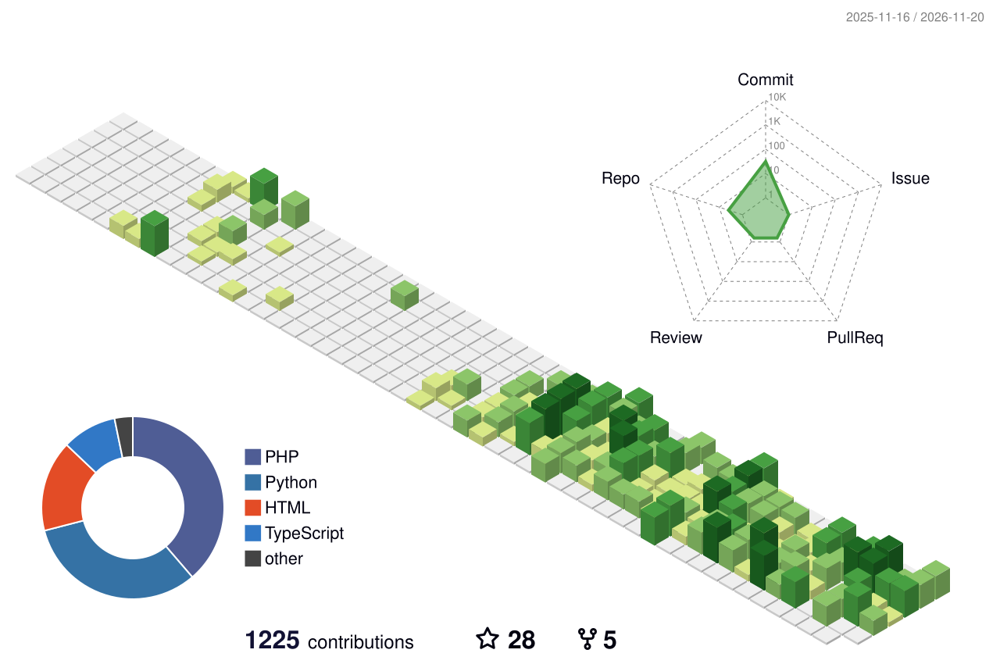

<!--
  github.com/zaferavci1 profile README
  Source of truth: ~/github-profile (PLAN.md, skills in .claude/skills). Facts here are checked against repo data in data/.
-->

<picture>
  <source media="(prefers-color-scheme: dark)" srcset="./assets/header-dark.svg">
  <source media="(prefers-color-scheme: light)" srcset="./assets/header-light.svg">
  
</picture>

  <a href="http://zaferavci.me"><b>zaferavci.me</b></a>&nbsp;&nbsp;·&nbsp;&nbsp;
  <a href="https://www.linkedin.com/in/zaferavci/">LinkedIn</a>&nbsp;&nbsp;·&nbsp;&nbsp;
  <a href="mailto:zaferavci89@gmail.com">zaferavci89@gmail.com</a>

I'm Zafer, a product-minded software developer from Hatay, Türkiye. I build the software behind real operations: production and costing tools for a manufacturer, an AI agent that turns order emails into ERP records, an education platform for tutoring centers, and a few iOS apps along the way.

I pick the stack per problem: **TypeScript and Next.js** for web platforms, **Python** for AI and data, **C# and .NET** for line-of-business systems, **Swift** for iOS.

> Most of my day-to-day work lives in private repositories for in-house teams and clients (1,150+ private contributions in 2026). This page describes that work; public repos are linked where they exist.

## What I'm working on

- **Operations software for a manufacturer.** Production planning, cost calculation, document control and fleet tracking. C# WinForms on SQL Server for the shop floor, Next.js + Electron + Prisma for the newer tools.
- **AI order agent.** A LangGraph workflow that reads order emails, extracts and checks them with an LLM against SQL data, waits for a human approval, then writes the order into the Netsis ERP.
- **Screen recording & RMM platform.** Windows agent, WebSocket ingest, FFmpeg job worker and an admin panel, run on-premise.
- **Quote & invoice system for a Swiss company.** Swiss QR-bills, German PDF documents, Turkish UI. Next.js, Prisma, PostgreSQL.
- **Programmatic video engine.** Remotion + React scenes rendered from JSON scripts, for long-form explainer videos.

## Selected projects

<table>
  <tr>
    <td width="50%" valign="top">
      <b>Dershane Takip Platformu</b> <code>private</code> · <a href="https://dershane-takip-platformu-admin.vercel.app">live demo</a> 
      Student tracking, exam analytics, question bank, study-room booking and gamification for LGS/YKS tutoring centers. One monorepo for API, admin panel and mobile app. 
      Express · Prisma · PostgreSQL · Next.js · Expo
    </td>
    <td width="50%" valign="top">
      <a href="https://github.com/zaferavci1/TurkishPetitionInsights"><b>TurkishPetition&shy;Insights</b></a> 
      Pulls names, dates, institutions, requests and tone out of Turkish petition PDFs with modular extractors and NLP models. 
      Python · Transformers · PyTorch · Streamlit
    </td>
  </tr>
  <tr>
    <td width="50%" valign="top">
      <a href="https://github.com/zaferavci1/ChessAgent"><b>ChessAgent</b></a> 
      Deep Q-learning chess agent: 16-plane bitboard input, a CNN value network and Stockfish as the teacher during training. 
      PyTorch · C++ · Stockfish
    </td>
    <td width="50%" valign="top">
      <a href="https://github.com/zaferavci1/TradingDashboard"><b>Trading Dashboard</b></a> 
      Mobile app for Gann-square levels, trade history and price alerts, backed by a FastAPI service that tracks live Binance and Yahoo Finance prices. 
      React Native · Expo · FastAPI · Supabase
    </td>
  </tr>
  <tr>
    <td width="50%" valign="top">
      <a href="https://github.com/zaferavci1/SpotifyTasiyici"><b>Spotify Taşıyıcı</b></a> 
      iOS app that moves your liked Spotify songs to Apple Music: matches tracks, builds a playlist and keeps transfer state locally. 
      Swift · SwiftUI · Spotify &amp; Apple Music APIs
    </td>
    <td width="50%" valign="top">
      <b>Cat Name Studio</b> <code>private</code> 
      iOS app that suggests cat names from a photo, with favorites, premium name packs, cat profiles and health reminders. 
      SwiftUI · Firebase · StoreKit 2
    </td>
  </tr>
</table>

Also public: <a href="https://github.com/zaferavci1/LoyalKullaniciTakibi">LoyalKullaniciTakibi</a> (HR, payroll and leave tracking, ASP.NET Core Razor Pages) · <a href="https://github.com/zaferavci1/zaferavci1.github.io">zaferavci1.github.io</a> (my portfolio site)

## Toolbox

<table>
  <tr>
    <td width="130"><b>Languages</b></td>
    <td>
      <picture>
        <source media="(prefers-color-scheme: dark)" srcset="https://skillicons.dev/icons?i=ts%2Cpy%2Ccs%2Cswift%2Ccpp%2Cphp&theme=dark">
        
      </picture>
    </td>
  </tr>
  <tr>
    <td><b>Web &amp; apps</b></td>
    <td>
      <picture>
        <source media="(prefers-color-scheme: dark)" srcset="https://skillicons.dev/icons?i=nextjs%2Creact%2Cnodejs%2Cexpress%2Ctailwind%2Cprisma%2Cdotnet%2Celectron&theme=dark">
        
      </picture>
    </td>
  </tr>
  <tr>
    <td><b>AI &amp; data</b></td>
    <td>
      <picture>
        <source media="(prefers-color-scheme: dark)" srcset="https://skillicons.dev/icons?i=pytorch%2Cfastapi&theme=dark">
        
      </picture>
      &nbsp;LangGraph · Hugging Face Transformers · NLTK · Streamlit
    </td>
  </tr>
  <tr>
    <td><b>Data &amp; infra</b></td>
    <td>
      <picture>
        <source media="(prefers-color-scheme: dark)" srcset="https://skillicons.dev/icons?i=postgres%2Cmysql%2Csqlite%2Csupabase%2Cfirebase%2Cdocker%2Cvercel%2Cgithubactions&theme=dark">
        
      </picture>
      &nbsp;SQL Server
    </td>
  </tr>
</table>

## Activity

<picture>
  <source media="(prefers-color-scheme: dark)" srcset="./profile-3d-contrib/profile-night-green.svg">
  <source media="(prefers-color-scheme: light)" srcset="./profile-3d-contrib/profile-green.svg">
  
</picture>

<b>Learning trail</b>: course work I've kept public since 2021

 

- **C# and .NET:** [Patika](https://github.com/zaferavci1/Patika), [Gencay Yıldız](https://github.com/zaferavci1/GencayYildiz), [Murat Yücedağ OOP](https://github.com/zaferavci1/MuratYucedag), [Engin Demiroğ camps](https://github.com/zaferavci1/Engin-Demirog)
- **SQL:** [Ömer Çolakoğlu](https://github.com/zaferavci1/Omer-Colakoglu)
- **Data and ML:** [Miuul Data Analytics](https://github.com/zaferavci1/Miuul), [Feature Engineering](https://github.com/zaferavci1/Feature-Engineering), [NLP](https://github.com/zaferavci1/NLP), [TensorFlow (BTK Akademi)](https://github.com/zaferavci1/Tensorflow), [Biopython](https://github.com/zaferavci1/Biyoinformatik)
- **Web:** [Django](https://github.com/zaferavci1/Django), [graduation project on ASP.NET](https://github.com/zaferavci1/Bitirme-WEB)

---

Open to project work and collaboration: web panels, mobile apps, data work and AI-assisted products.

